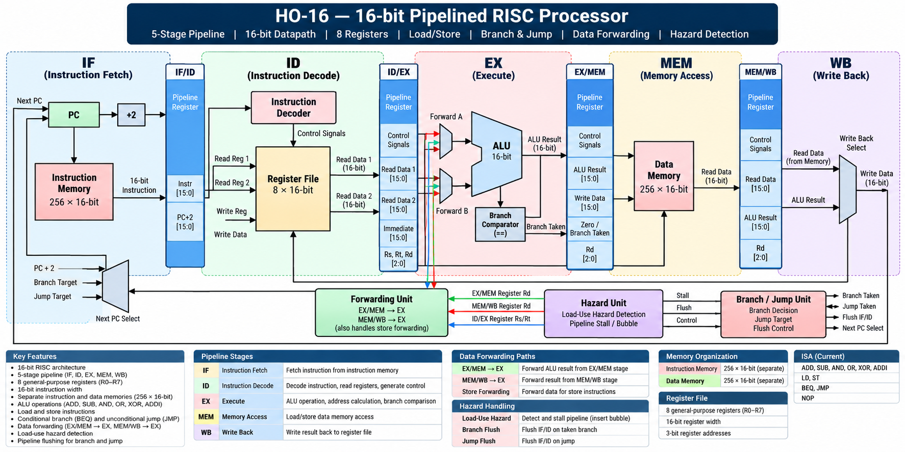

# HO-16 — 16-bit Pipelined RISC Processor

HO-16 is a custom 16-bit RISC processor designed and implemented from RTL using Verilog.

The project covers the complete processor development flow:

**ISA → RTL Design → Simulation → Hazard Handling → Pipelining → Synthesis → FPGA Place & Route → Timing Analysis**

---

## Overview

HO-16 is a compact 16-bit RISC processor with:

- 16-bit instruction width
- 16-bit datapath
- 8 general-purpose registers
- 5-stage pipeline
- Separate instruction and data memories
- ALU-based arithmetic and logical operations
- Load/store data path
- Conditional branching
- Unconditional jumps
- Data forwarding
- Load-use hazard detection
- Pipeline flushing
- FPGA-oriented synthesis and timing analysis

The processor was developed completely at RTL and verified using simulation before synthesis and place-and-route analysis.

---

## Architecture



### Processor Configuration

| Parameter | Value |
|---|---:|
| Architecture | 16-bit RISC |
| Instruction width | 16 bits |
| Register count | 8 |
| Register width | 16 bits |
| Instruction memory | 256 × 16-bit |
| Data memory | 256 × 16-bit |
| Pipeline stages | 5 |

### Register Set

```text
R0 R1 R2 R3 R4 R5 R6 R7
```

The processor uses 3-bit register identifiers.

---

## Pipeline

HO-16 uses a classic five-stage pipeline:

```text
        ┌─────┐
        │  IF │  Instruction Fetch
        └──┬──┘
           │
        ┌──▼────┐
        │ IF/ID │
        └──┬────┘
           │
        ┌──▼───┐
        │  ID  │  Instruction Decode
        └──┬───┘
           │
        ┌──▼────┐
        │ ID/EX │
        └──┬────┘
           │
        ┌──▼───┐
        │  EX  │  Execute / ALU
        └──┬───┘
           │
        ┌──▼────┐
        │ EX/MEM│
        └──┬────┘
           │
        ┌──▼───┐
        │ MEM  │  Memory Access
        └──┬───┘
           │
        ┌──▼────┐
        │ MEM/WB│
        └──┬────┘
           │
        ┌──▼───┐
        │  WB  │  Write Back
        └──────┘
```

Pipeline registers:

- IF/ID
- ID/EX
- EX/MEM
- MEM/WB

---

## Instruction Set

The current ISA includes:

| Instruction | Operation |
|---|---|
| `ADD` | Register addition |
| `SUB` | Register subtraction |
| `AND` | Bitwise AND |
| `OR` | Bitwise OR |
| `XOR` | Bitwise XOR |
| `ADDI` | Immediate addition |
| `LD` | Load from data memory |
| `ST` | Store to data memory |
| `BEQ` | Conditional branch |
| `JMP` | Unconditional jump |
| `NOP` | No operation |

---

## Hazard Handling

The pipeline includes mechanisms for handling data and control hazards.

### 1. Data Forwarding

Results can be forwarded from later pipeline stages to the execute stage to reduce unnecessary stalls.

Forwarding paths include:

```text
EX/MEM ───────► EX
MEM/WB ───────► EX
```

The implementation also handles forwarding required for store instructions.

### 2. Load-Use Hazard Detection

A load instruction followed immediately by an instruction that uses the loaded value creates a dependency that cannot be resolved using normal EX forwarding.

The hazard unit detects this condition and inserts a pipeline stall/bubble.

```text
LD   R6, [R1+5]
ADD  R5, R6, R2
     ↑
 load-use dependency
```

### 3. Branch Flush

When a conditional branch is taken, instructions fetched from the wrong path are flushed.

### 4. Jump Flush

Unconditional jumps also flush instructions belonging to the wrong sequential path.

---

## Verification

The processor was verified using Icarus Verilog and GTKWave.

The final regression verifies:

- Arithmetic operations
- Logical operations
- Load/store operation
- Load-use hazard
- ALU forwarding
- MEM/WB forwarding
- Store-data forwarding
- Conditional branch
- Branch flushing
- Jump flushing
- Final register and memory results

### Final Regression

```text
PASS: ADD      R3  =    35
PASS: SUB      R4  =    10
PASS: LOAD/USE R5  =   133
PASS: STORE     MEM[30] =   133
PASS: BRANCH/JUMP FLUSH R7 =     0
PASS: BRANCH/JUMP TARGET R6 =   128
```

---

## Synthesis

The design was synthesized using Yosys for an ECP5 FPGA target.

### Final Resource Usage

| Resource | Usage |
|---|---:|
| LUT4 | 510 |
| Logic LUT4 | 398 |
| Carry LUT4 | 64 |
| RAM LUT4 | 32 |
| RAMW LUT4 | 16 |
| Flip-Flops | 180 |
| DP16KD Block RAM | 2 |

These values are from the final ECP5 synthesis/place-and-route flow.

---

## Timing Analysis

The final design was placed and routed using `nextpnr-ecp5`.

### Final Timing Result

```text
Estimated Fmax:       84.34 MHz
Critical path:        11.86 ns
Logic delay:           6.58 ns
Routing delay:         5.28 ns
Target frequency:     50.00 MHz
Timing status:        PASS
```

The 84.34 MHz figure is an **ECP5 place-and-route timing estimate**, not a measurement from physical FPGA hardware.

---

## Target FPGA

The design was evaluated using an ECP5 target configuration:

```text
Device : ECP5 85K
Package: CABGA381
Speed  : -8
```

No physical FPGA board was required for the RTL verification and timing-analysis stage.

---

## Project Structure

```text
HO-16/
│
├── rtl/
│   ├── alu.v
│   ├── register_file.v
│   ├── instruction_decoder.v
│   ├── control_unit.v
│   ├── program_counter.v
│   ├── instruction_memory.v
│   ├── fetch_unit.v
│   ├── data_memory.v
│   ├── branch_unit.v
│   │
│   ├── if_id_register.v
│   ├── id_ex_register.v
│   ├── ex_mem_register.v
│   ├── mem_wb_register.v
│   │
│   ├── hazard_unit.v
│   ├── forwarding_unit.v
│   └── ho16_pipeline.v
│
├── tb/
│   ├── alu_tb.v
│   ├── register_file_tb.v
│   ├── instruction_decoder_tb.v
│   ├── control_unit_tb.v
│   ├── ...
│   └── final_regression_tb.v
│
├── docs/
│   ├── ISA.md
│   └── ECP5_BASELINE.md
│
├── sim/
│   └── synthesis / timing reports
│
├── synth.ys
├── synth_ecp5.ys
├── synth_pipeline_ecp5.ys
├── synth_pipeline_timing.ys
└── README.md
```
## Build Targets

The repository contains both the original single-cycle implementation
and the final pipelined implementation.

### Final Processor

The primary processor implementation is:

```text
rtl/ho16_pipeline.v
```

The final ECP5 synthesis flow uses:

```text
synth_pipeline_ecp5.ys
```

with:

```text
ho16_pipeline
```

as the synthesis top.

For timing-oriented analysis, the wrapper:

```text
rtl/ho16_pipeline_timing_top.v
```

is used with:

```text
synth_pipeline_timing.ys
```

### Earlier Single-Cycle Implementation

The earlier processor implementation is retained for development history
and comparison:

```text
rtl/ho16_processor.v
rtl/ho16_synth_top.v
rtl/ho16_timing_top.v
```

The corresponding synthesis scripts are:

```text
synth.ys
synth_ecp5.ys
synth_ecp5_timing.ys
```

---

## Tools

The project was developed using:

- Verilog HDL
- Icarus Verilog
- GTKWave
- Yosys
- OSS CAD Suite
- nextpnr-ecp5
- VS Code

---

## Design Flow

```text
        ISA Definition
              │
              ▼
        RTL Development
              │
              ▼
        Module Simulation
              │
              ▼
       Processor Integration
              │
              ▼
       Pipeline Development
              │
              ▼
     Hazard & Forwarding Logic
              │
              ▼
       Functional Regression
              │
              ▼
          Yosys Synthesis
              │
              ▼
      ECP5 Technology Mapping
              │
              ▼
       nextpnr Place & Route
              │
              ▼
        Timing Analysis
```

---

## Future Improvements

Possible future development includes:

- Larger instruction set
- More registers
- Improved branch handling
- Branch prediction
- CSR support
- Interrupt support
- Memory-mapped I/O
- UART peripheral
- FPGA hardware implementation
- Performance benchmarking
- Formal verification
- Improved timing optimization

---

## Project Status

**Current status: Functional RTL + pipelined processor + hazard handling + ECP5 synthesis + place-and-route timing analysis completed.**

The current implementation passes the final processor regression and achieves an estimated **84.34 MHz maximum frequency** in the selected ECP5 place-and-route flow.

---

## Author

**Harsh Ozare**

Electronics Engineering  
Veermata Jijabai Technological Institute (VJTI)
